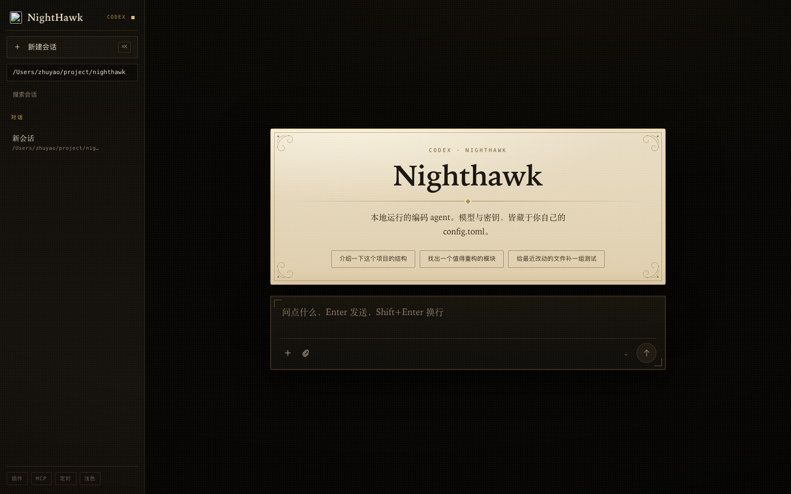

# NightHawk CLI

[](LICENSE) [](https://alicegoto.github.io/nighthawk/en/) <br>
[Documentation](https://alicegoto.github.io/nighthawk/en/) · [Issues](https://github.com/AliceGoto/nighthawk/issues) · [中文](README.zh-CN.md)



## What is NightHawk CLI

NightHawk CLI is an AI coding agent that runs in your terminal — it can read and edit code, run shell commands, search files, fetch web pages, and choose the next step based on the feedback it receives. It uses DeepSeek by default and can connect to any OpenAI-compatible provider — configure providers in `config.toml` or the Web provider panel.

## Install

**macOS on Apple silicon** — download `nighthawk-darwin-arm64.tar.gz` from [Releases](https://github.com/AliceGoto/nighthawk/releases), then extract it and check the binary:

```sh
tar -xzf nighthawk-darwin-arm64.tar.gz
./nighthawk --version
```

Move `nighthawk` into a directory on your `PATH` so you can run it from any project.

**Other platforms** — build from source. Requirements: Node.js ≥ 24.15.0, pnpm 10.33.0.

```sh
git clone https://github.com/AliceGoto/nighthawk.git
cd nighthawk
pnpm install
pnpm build
```

Run the built CLI with `node apps/nighthawk/dist/main.mjs`, or run `pnpm link --global` inside `apps/nighthawk` to put `nighthawk` on your `PATH`.

> On Windows, install [Git for Windows](https://gitforwindows.org/) before first launch because NightHawk CLI uses the bundled Git Bash as its shell environment. If Git Bash is installed in a custom location, set `NIGHTHAWK_SHELL_PATH` to the absolute path of `bash.exe`.

Before your first session, configure a provider and API key — see [Providers](https://alicegoto.github.io/nighthawk/en/configuration/providers) for `config.toml` and the Web provider panel.

## Quick Start

Open a project and start the interactive UI:

```sh
cd your-project
nighthawk
```

On first launch, configure a provider and API key as described above, then try your first task:

```
Take a look at this project and explain its main directories.
```

## Key Features

- **Single-binary distribution.** One tarball, no Node.js setup, PATH gymnastics, or global module conflicts.
- **Blazing-fast startup.** The TUI is ready in milliseconds, so starting a session never feels heavy.
- **Purpose-built TUI.** A carefully tuned interface, optimized end to end for long, focused agent sessions.
- **Video input.** Drop a screen recording or demo clip into the chat and let the agent watch what is hard to describe in words — turn a reference clip into a LUT, a long video into a short, a screen recording into working code, and more.
- **AI-native MCP configuration.** Add, edit, and authenticate Model Context Protocol servers conversationally with `/mcp-config`, without hand-editing JSON.
- **Rich plugin ecosystem.** Install skills, MCP servers, and data sources from the marketplace or any GitHub repo, with each install's trust level surfaced up front.
- **Subagents for focused, parallel work.** Dispatch built-in `coder`, `explore`, and `plan` subagents in isolated contexts while keeping the main conversation clean.
- **Lifecycle hooks.** Run local commands at key points to gate risky tool calls, audit decisions, trigger desktop notifications, or connect to your own automation.
- **Editor & IDE integration (ACP).** Drive a NightHawk CLI session straight from Zed, JetBrains, or any [Agent Client Protocol](https://agentclientprotocol.com/) client with `nighthawk acp`.
- **Browser UI.** Run `nighthawk web` for a local web client with sessions, approvals, attachments, providers, skills, and scheduled tasks — same data as the CLI.

## Use it in your editor (ACP)

NightHawk CLI speaks the [Agent Client Protocol](https://agentclientprotocol.com/), so ACP-compatible editors and IDEs (Zed, JetBrains, …) can drive a session over stdio. Configure a provider once, then point your editor at the `nighthawk acp` subcommand — no extra setup needed.

For Zed, add this to `~/.config/zed/settings.json`:

```json
{
  "agent_servers": {
    "NightHawk CLI": {
      "type": "custom",
      "command": "nighthawk",
      "args": ["acp"],
      "env": {}
    }
  }
}
```

Then open a new conversation in Zed's Agent panel. See [Using in IDEs](https://alicegoto.github.io/nighthawk/en/guides/ides) for JetBrains setup and troubleshooting, and the [`nighthawk acp` reference](https://alicegoto.github.io/nighthawk/en/reference/nighthawk-acp) for the full capability matrix.

## Docs

- [Getting Started](https://alicegoto.github.io/nighthawk/en/guides/getting-started)
- [Interaction and approvals](https://alicegoto.github.io/nighthawk/en/guides/interaction)
- [Sessions](https://alicegoto.github.io/nighthawk/en/guides/sessions)
- [Using in IDEs (ACP)](https://alicegoto.github.io/nighthawk/en/guides/ides)
- [Configuration](https://alicegoto.github.io/nighthawk/en/configuration/config-files)
- [Command reference](https://alicegoto.github.io/nighthawk/en/reference/nighthawk-command)

## Develop

Requirements: Node.js ≥ 24.15.0, pnpm 10.33.0.

```sh
git clone https://github.com/AliceGoto/nighthawk.git
cd nighthawk
pnpm install
```

```sh
pnpm dev:cli    # run the CLI in dev mode
pnpm test       # run tests
pnpm typecheck  # TypeScript check
pnpm lint       # oxlint
pnpm build      # build all packages
```

See [CONTRIBUTING.md](CONTRIBUTING.md) for the full contribution guide.

## Community

- [Issues](https://github.com/AliceGoto/nighthawk/issues)
- For security vulnerabilities, see [SECURITY.md](SECURITY.md).

## Star history

[](https://star-history.com/#AliceGoto/nighthawk&Timeline)

## Acknowledgements

Our TUI is built on top of [`pi-tui`](https://github.com/earendil-works/pi-mono/tree/main/packages/tui). We thank the authors of `pi-tui` for their valuable work.

## License

Released under the [MIT License](LICENSE).
