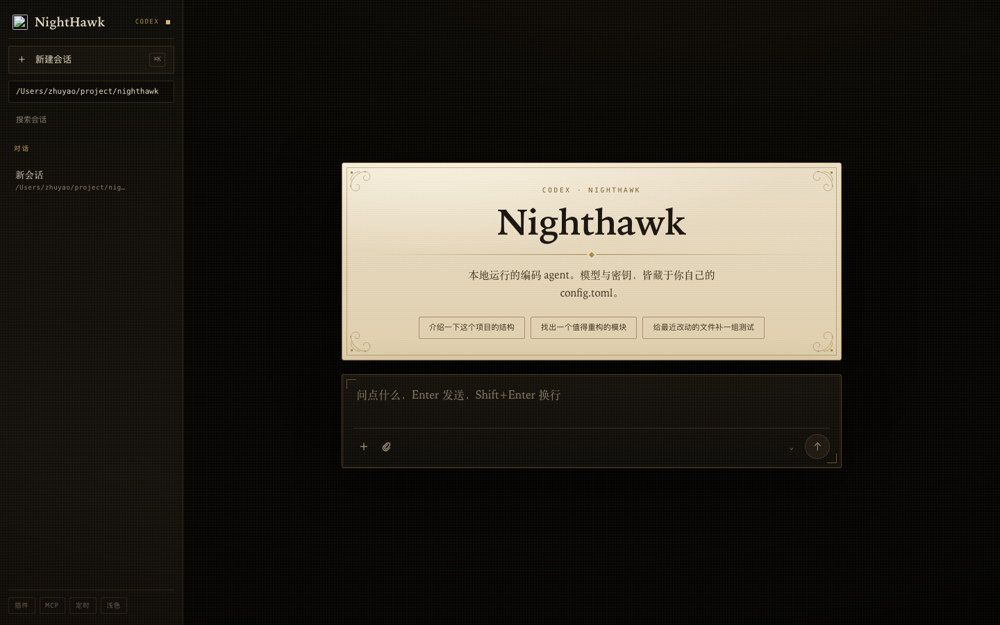
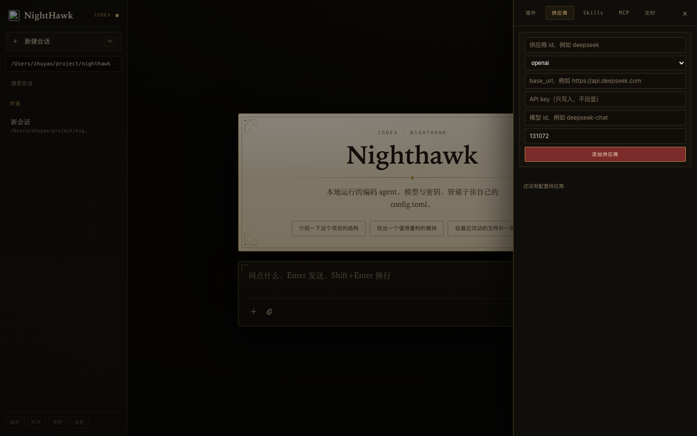

# Using NightHawk in the browser

NightHawk Web is the browser-based graphical interface built into NightHawk CLI: run `nighthawk web` in a terminal, and you can start sessions, chat, handle approvals, and review file changes in a browser — a friendlier interface, while sessions and data still live entirely on your machine.



## Getting started

<div class="step">
<span class="step-num">1</span> <strong>Install NightHawk CLI and configure a provider</strong>

`nighthawk web` is a built-in CLI command — it isn't available without the CLI. See [Getting started](./getting-started.md) for installation and provider configuration.
</div>

<div class="step">
<span class="step-num">2</span> <strong>Run <code>nighthawk web</code> in a terminal</strong>

If you're already in the CLI, you can also type `/web` to hand the current session off to the browser.
</div>

<div class="step">
<span class="step-num">3</span> <strong>The web UI opens in your default browser once ready</strong>

The startup banner prints the access URL — if the browser doesn't open by itself, copy this URL and open it manually:

```text
Local:   http://127.0.0.1:58627/#token=...
Token:   ...
Stop:    Ctrl+C
```

::: warning
The `#token=` fragment is the access credential — don't share it. Stop the server with `Ctrl+C` in the terminal.
:::
</div>

### Startup options

| Option | Description |
| --- | --- |
| `--port <port>` | Bind port; defaults to `58627`, auto-increments when taken |
| `--host [host]` | Let phones, tablets, or other computers on the same LAN access the web address; you can also specify an IP, e.g. `--host 192.168.1.10` |
| `--no-open` | Don't open the browser when ready |
| `--log-level <level>` | Enable server logs at the given level; off by default |

### Common slash commands

| Slash command | Description |
| --- | --- |
| `/new` | Start a new session |
| `/goal` | Enter Goal mode and keep working toward the same objective across turns |
| `/compact` | Compact the current session's context |
| `/tower` | [Tower multi-agent collaboration](./tower.md) (experimental); `/tower <base-branch>` sets the base branch without sending an objective |
| `/export` | Export the session content and troubleshooting logs as a ZIP |
| `/remote-control` | Enable remote control to access the local web session remotely |

## Managing providers

Provider changes made in the web UI are written to the same `config.toml` the CLI reads. Open **Providers** from the sidebar footer to add a provider, set a default model, or edit and delete an existing one.



## Relationship with the CLI

The web UI and the CLI share the same provider configuration (`config.toml`) and session data.

The web UI supports only a subset of the CLI's slash commands — see [Common slash commands](#common-slash-commands) above. Everything else usually has a point-and-click equivalent in the UI (the model picker, the provider sheet, the plugin and MCP lists, the cron panel).

How the two sides compare:

<div class="feature-compare-table">

| Feature | CLI | Web | Notes |
| --- | --- | --- | --- |
| Streaming chat | ✓ | ✓ | Web renders rich formats incrementally (tables, code highlighting, diffs, tool cards) |
| Session management | ✓ | ✓ | Create, rename, delete, and export a session as a ZIP |
| Approvals and questions | ✓ | ✓ | Click to approve or answer in the UI — no commands needed |
| Attachments | ✓ | ✓ | Upload or paste images and files into the prompt |
| Providers | ✓ | ✓ | Add, edit, delete, and set a default model from the provider sheet |
| Skills | ✓ | ✓ | List the skills available to a session and activate one |
| Scheduled tasks | ✓ | ✓ | Create, view, and delete cron tasks for a session |
| Plugins and MCP | ✓ | ✓ | Browse installed plugins and configured MCP servers |
| Themes | — | ✓ | Dark and light |
| Mobile layout | — | ✓ | With LAN sharing on (`--host`), it works in phone browsers on the same network |

</div>

## Security notes

- **Set a parallel credential**: when binding a LAN address, also set the `NIGHTHAWK_PASSWORD` environment variable; the server then rate-limits authentication failures automatically.
- **Don't disable authentication entirely**: `--dangerous-bypass-auth` turns off all authentication — anyone who can reach the port can control your sessions, file system, and shell. Only use it on trusted networks or behind your own authenticating proxy. See the [nighthawk command reference](../reference/nighthawk-command.md#nighthawk-web).

## FAQ

### The port is already taken

Nothing to do. `nighthawk web` automatically retries with the next port (58628, 58629, …) — just use the address printed in the startup banner.

### The URL won't open in the browser

First check the server is still running in the terminal (it runs in the foreground there). Copy the full URL including the `#token=` part; opening only `http://127.0.0.1:58627` lands on a token input page, where pasting the `Token` value from the banner also works.

### How to recover from an invalid token

Run `nighthawk web rotate-token` to generate a new token, then open the new banner URL. All running instances switch to the new token automatically — no restart needed.

### Other devices on the same Wi-Fi can't connect

Make sure you started with `--host` (bare is fine), and use the LAN URL from the banner (like `http://192.168.x.x:58627/#token=...`). If it still fails, check that the machine's firewall allows the port, and that both devices are really on the same network segment — guest Wi-Fi, VPNs, and switching to a 4G/5G hotspot all isolate devices.

## Next steps

- [Server API](../reference/server-api.md) — REST / WebSocket APIs for scripts and third-party integrations (experimental)
- [nighthawk command](../reference/nighthawk-command.md#nighthawk-web) — all `nighthawk web` command-line options
- [Remote Control](./remote-control.md) — remotely view and take over local sessions from any device over the public internet
